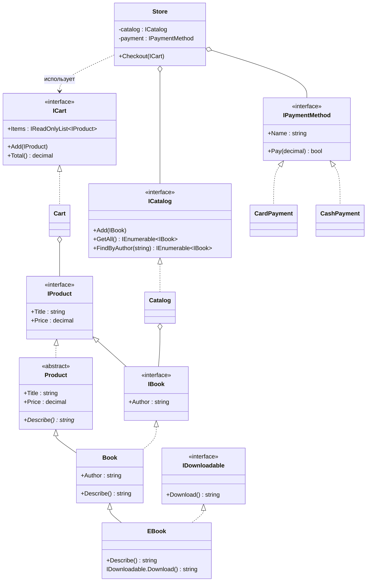

# Книжный магазин — UML-диаграмма классов

## Обозначения

- `<|--` — наследование (класс от класса, интерфейс от интерфейса)
- `<|..` — реализация интерфейса
- `o--` — агрегация (объект хранит ссылку на другой)
- `..>` — зависимость (использует в методе)
